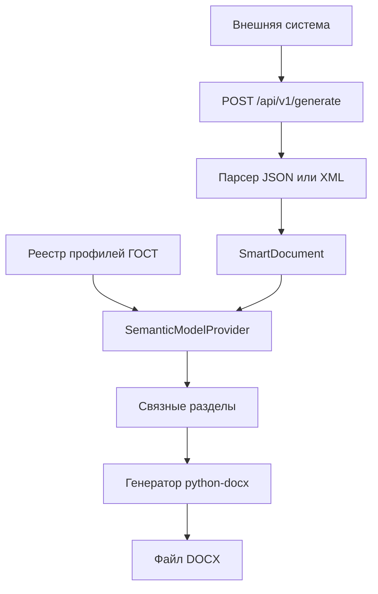

# smart2docx

Модуль формирования текстовых документов DOCX по ГОСТ на основе smart-документов.

Модуль встраивается во внешнюю BIM-систему или систему ведения государственных реестров. Вызывающая сторона передаёт готовый машиночитаемый smart-документ и идентификатор шаблона. Модуль возвращает оформленный файл `.docx`. Источник исходных данных значения не имеет: на вход принимается уже собранный JSON или XML.

## Назначение

Один вызов закрывает цепочку от структурированного описания объекта до человекочитаемого документа:

- `GET /health` — проверка доступности;
- `GET /api/v1/templates` — список профилей ГОСТ;
- `POST /api/v1/generate` — сборка `.docx`.

Поддерживаемые профили:

| Идентификатор | Документ | Нормативная опора |
| --- | --- | --- |
| `gost_explanatory_note` | Пояснительная записка | ГОСТ Р 21.101-2020, Постановление Правительства РФ от 16.02.2008 № 87 |
| `gost_tech_spec` | Техническое задание | ГОСТ 2.105-2019 |
| `gost_contract` | Договор / акт | ГОСТ Р 7.0.97-2016 |

Общее оформление: лист A4, поля 30/15/20/20 мм (левое, правое, верхнее, нижнее), Times New Roman 14 пт, межстрочный интервал 1,5, абзацный отступ 1,25 см, нумерация страниц, таблицы с границами и шапкой.

## Пайплайн



`SemanticModelProvider` — граница языковой модели. В поставке работает `MockSemanticProvider`: детерминированная сборка инженерного текста из реквизитов, параметров, требований и таблиц. Внешний API и ключ доступа не требуются. Реализация с языковой моделью подключается вместо mock-провайдера без изменения HTTP-контракта.

## Структура репозитория

```text
src/smart2docx/
  main.py            HTTP-приложение
  service.py         сборка документа одним вызовом
  schemas/           модели smart-документа и запроса
  parsers/           JSON и XML
  semantic/          интерфейс поставщика текста и mock-реализация
  templates/         профили ГОСТ и реестр
  builder/           оформление и запись DOCX
examples/            входные smart-документы
tests/               pytest
```

Smart-документ содержит реквизиты объекта, разделы, параметры, требования и таблицы характеристик. Имена полей принимаются в `snake_case` и `camelCase`. Неизвестные поля не прерывают разбор.

## Модель ветвления

- `main` — устойчивое состояние модуля.
- `feat/*` — новая функциональность.
- `fix/*` — исправление дефектов.

Сообщения коммитов — Conventional Commits: `feat`, `fix`, `test`, `docs`, `chore`, `refactor`.

## Запуск

Требуется Python 3.11 или новее.

```bash
python -m venv .venv
source .venv/bin/activate
pip install -r requirements.txt
pip install -e .
uvicorn smart2docx.main:app --host 127.0.0.1 --port 8000
```

Эквивалентный запуск: `smart2docx` или `python -m smart2docx`.

Программный вызов без HTTP:

```python
from pathlib import Path

from smart2docx.parsers import parse_document
from smart2docx.service import generate_document

document = parse_document(
    Path("examples/structural_solutions.json").read_text(encoding="utf-8")
)
result = generate_document(document, "gost_explanatory_note")
Path(result.filename).write_bytes(result.content)
```

## Пример запроса

Список шаблонов:

```bash
curl -sS http://127.0.0.1:8000/api/v1/templates
```

Файл JSON:

```bash
curl -sS -X POST "http://127.0.0.1:8000/api/v1/generate" \
  -F "template_id=gost_explanatory_note" \
  -F "file=@examples/structural_solutions.json;type=application/json" \
  -o pz.docx
```

Файл XML:

```bash
curl -sS -X POST "http://127.0.0.1:8000/api/v1/generate" \
  -F "template_id=gost_explanatory_note" \
  -F "file=@examples/architectural_solutions.xml;type=application/xml" \
  -o ar.docx
```

Тело JSON. Поле `document` — smart-документ, `template_id` — профиль. Допустима и передача самого smart-документа, если `template_id` указан параметром запроса.

```bash
python -c 'import json, pathlib; source = json.loads(pathlib.Path("examples/structural_solutions.json").read_text(encoding="utf-8")); pathlib.Path("/tmp/smart2docx-request.json").write_text(json.dumps({"template_id": "gost_explanatory_note", "document": source}, ensure_ascii=False), encoding="utf-8")'
curl -sS -X POST "http://127.0.0.1:8000/api/v1/generate" \
  -H "Content-Type: application/json" \
  --data-binary @/tmp/smart2docx-request.json \
  -o pz.docx
```

Ответ — файл DOCX. `Content-Type` равен `application/vnd.openxmlformats-officedocument.wordprocessingml.document`, `Content-Disposition` содержит имя файла.

## Тесты

```bash
pytest
```

Проверяются разбор JSON и XML, mock-провайдер, геометрия листа, абзацные стили, таблицы, эндпоинты и оба примера из `examples/`.

## Ограничения текущей версии

`MockSemanticProvider` собирает связный текст по фиксированным формулировкам и не обращается к языковой модели. Числовые характеристики переносятся из smart-документа без инженерной проверки расчёта. Полученный DOCX является проектом документа и подлежит проверке ответственным исполнителем.

## Дорожная карта

1. Реализация `SemanticModelProvider` поверх языковой модели с тем же контрактом `render`.
2. Шаблоны ведомостей и спецификаций оборудования.
3. Подключение файла DOTX со штампом ГОСТ Р 21.101.
4. Пакетная сборка комплекта разделов одним запросом.
5. Проверка полноты обязательных характеристик до записи DOCX.
